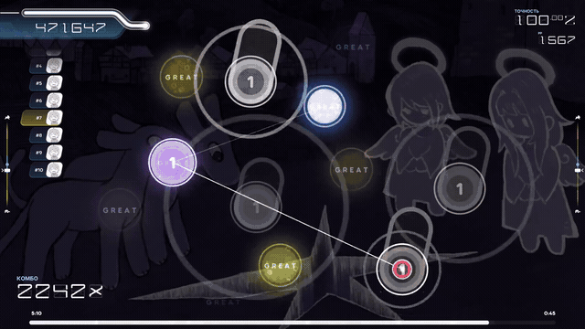
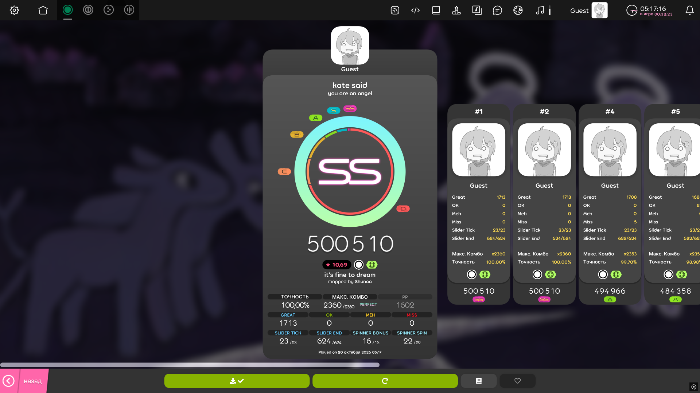
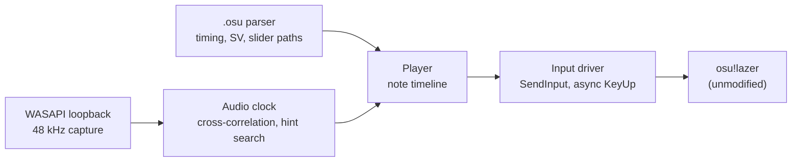

<div align="center">

# osu! agent: plays osu!lazer from the outside

[](https://github.com/Bileneret/osu-agent/actions/workflows/ci.yml)
[](https://www.python.org/downloads/)
[](LICENSE)

[](#key-metrics)
[](https://vshymanskyy.github.io/StandWithUkraine/)

[Русская версия](README.ru.md)

> Reads the beatmap, synchronizes with the music through a sound-card loopback, and presses the keys at the right millisecond — without touching the game.

[▶ Full demo: 58 seconds (10.69-star, no audio)](docs/demo/ss-kate-said.mp4)



*Live gameplay (14 s): the closing section of the map, combo over 2000.*



*Result screen of the 10.69-star map: 100.00%, GREAT 1713/1713, MISS 0, MAX COMBO 2360/2360.*

<a href="https://vshymanskyy.github.io/StandWithUkraine/">
  
</a>

</div>

---

## What this is

An agent that plays **osu!lazer** on unranked maps, fully offline, using only the
outside of the game: it watches the screen, listens to the sound card, and sends
keyboard and mouse events through the regular Windows input API. The beatmap
`.osu` file is known in advance, so no computer vision and no reaction are
involved — timing comes from the music itself.

Boundaries, on purpose: the game client is not modified, process memory is not
read, results are never submitted anywhere, and the game is played from a guest
account. This is an engineering showcase, not a tool for online play — see the
disclaimer at the bottom.

---

## Key metrics

*Measured on the target machine (Windows 11, 1920×1080@120 FPS, Realtek output, osu!lazer 2026.1005.0):*

| What | Result | Where it comes from |
| --- | --- | --- |
| **Rank SS** on `you are an angel — kate said` **[it's fine to dream] (10.69-star, OD10)** | **100.00%**, GREAT 1713/1713, MISS 0, MAX COMBO 2360/2360 (PERFECT), 500 510 pts | `docs/evidence/ss-kate-said-45.png`, `docs/evidence/ss-kate-said-45.log.txt` |
| Control run on the same map | 99.96%, GREAT 1712, OK 1, **MISS 0** | `docs/evidence/ss-kate-said-46-control.png` |
| **SS** on `Good Girls (Don't Get Used) [pearto's Easy / Normal / Hard]` (1.54-star OD2 / 2.09-star OD3.5 / 3.04-star OD6) | **100.00%** on each, MISS 0 | `docs/evidence/ss-good-girls-*.png` |
| 4-star `[serodose's Insane]` (4.24-star, OD8) | 96.91%, GREAT 392, OK 23, **MISS 0**, MAX COMBO 583/583 | `docs/evidence/s-good-girls-4star-od8.png` |
| Timing telemetry (tap dispatch error) | p50 **0.0 ms**, p95 **≤ 0.01 ms**, max ≤ 2.6 ms | run logs, `send_p*_ms` fields |
| Offline test suite | **22 passed** | `pytest -q` |

---

## Before / after

*The whole project in one table — measured accuracies on the same map set, in the order they were achieved:*

| Stage | Accuracy | What changed |
| --- | --- | --- |
| First hitting attempt (day 3) | 0.07% | correct timing model, but the playfield formula was wrong (40–84 px cursor error) |
| After the coordinate fix | 46.29% | `X = 384 + 2.25·x`, `Y = 126 + 2.25·y` verified to 0.5 px |
| After slider holding fix | 96.71% | ×1000 dimension bug in slider following |
| Easy / Normal / Hard | **100.00%** each | anchor corrections, free-key selection, cursor lead |
| `kate said` 10.69-star | 43.08% → **100.00%** | quiet intro handling: Δ calibration on warm-ups, predicted start, correlation re-lock |

---

## Architecture

The agent is feed-forward: the beatmap is known, so the only live input it needs
is "where is the music right now".



| Layer | What it does |
| --- | --- |
| `osu_agent/beatmap.py` | `.osu` parser: timing points, slider multiplier, green-line SV, slider end times |
| `osu_agent/slider_path.py` | slider geometry: linear / Bézier / centripetal Catmull-Rom / perfect-circle paths, clipped to length |
| `osu_agent/audio_clock.py` | loopback capture, normalized cross-correlation with the reference track, hint-based search, onset detection |
| `osu_agent/player.py` | note timeline, predicted start (Δ), correlation re-lock, EMA clock smoothing, density-based kinematics |
| `osu_agent/input_driver.py` | DPI-aware SendInput, non-blocking KeyUp via a releaser thread, free-key selection, process/thread priority boost |
| `spike/run_map.py` | run orchestrator: brings the game to a pause, calibrates, plays a map, screenshots the result |

---

## Engineering highlights

**The 89-pixel cursor error.** The first runs scored 0.07% with a "perfectly
positioned" cursor. The playfield is not stretched to the full 1080p height: in
lazer it is 0.8 of the logical 1024×768 with an 8-unit vertical shift, giving
`X = 384 + 2.25·x`, `Y = 126 + 2.25·y`. Verified with HoughCircles against real
screenshots: the old formula missed by 40–84 px (up to 191 px at the edges), the
new one is within 0.5–1 px. Accuracy after the fix: 0.07% → 46.29%.

**The thousand-fold slider bug.** `progress = (time - start) · velocity` mixed
seconds with osu-pixels per *millisecond*: the cursor stayed glued to the slider
head, and the huge follow area masked it on easy maps. `velocity_sec =
velocity_ms × 1000` plus a dimension-guard test; slider ticks and ends went to
49/49 and 86/86 on the easy map.

**Busy-waiting starved the recorder.** A spin-wait loop in the main thread held
the GIL and starved the loopback capture thread: capture blocks arrived with
gaps, the recorded end-time stopped matching the concatenated signal, and the
onset estimate drifted by up to +75 ms. Replaced with `sleep` + a sub-3 ms spin:
anchor corrections returned to the ±20 ms range.

**A quiet intro broke the start.** On `kate said` the track begins with 3.1 s of
silence and the first note sits at 5.659 s, so loudness-based onset detection
latched onto the first *loud* sound (+1.95 s late), while correlation could only
see the track after the first note. Fixed by calibrating Δ (click → track start)
over warm-up runs — the first run after a pause is cold (1.684 → 1.620 s), so it
is discarded — and playing the first notes on the predicted start while a
background watcher re-locks the clock (+13 ms in the SS run). Result: MISS 0.

**Phase jumps in the clock.** The relocator used to hard-replace the anchor,
injecting ±2–5 ms of correlation noise as instant phase steps — on OD10 (±10 ms)
that alone pushed notes into OK. Exponential smoothing (`anchor -= 0.15 · err`)
plus density-based kinematics (tap hold 18 ms, slider-tail hold 5 ms) took the OK
count from 99 to 22 on the same map.

---

## Project structure

```text
osu-agent/
├── osu_agent/                 # core package
│   ├── beatmap.py             # .osu parser (timing, SV, sliders)
│   ├── slider_path.py         # slider path geometry
│   ├── audio_clock.py         # loopback capture + cross-correlation clock
│   ├── player.py              # timeline executor (circles, sliders, spinners)
│   └── input_driver.py        # SendInput driver, priorities, async KeyUp
├── spike/                     # the engineering log: every experiment, incl. failures
│   ├── run_map.py             # run orchestrator (the entry point)
│   ├── run_ss.py              # convenience wrapper for the SS map
│   └── diag_*.py, measure_*.py, ...   # calibration and diagnostics scripts
├── tests/                     # offline unit tests (22)
├── docs/
│   ├── demo/ss-kate-said.mp4  # 58-second demo (10.69-star, no audio)
│   ├── evidence/              # result screenshots and run logs
│   ├── day*.md                # day-1..3 engineering reports
│   └── prior_art_osu_bots.md  # what other osu! bots do, and why they differ
├── osu_plan.md                # the working plan and decision log
├── requirements.txt
└── .env.example               # configuration reference (not a runtime file)
```

---

## Quick start

### Prerequisites

- Windows 10/11, Python 3.12
- osu!lazer installed (unmodified), logged out to a guest session
- The beatmap `.osu` file and its audio track available locally (not shipped here)

### Installation

```bash
python -m venv .venv
.venv/Scripts/pip install -r requirements.txt
```

### Tests

```bash
.venv/Scripts/python -m pytest tests -q
```

The suite is offline: it runs without the game, without a sound device and
without the beatmaps.

### Usage

```bash
.venv/Scripts/python spike/run_map.py \
    --osu path/to/beatmap.osu \
    --audio path/to/track.mp3 \
    --cpu -1
```

The runner brings the game to the pause screen (song select / results / fail
screens are recognized by color), calibrates the track start, plays the map, and
saves the result screenshot. Useful flags: `--test` (play only the first
object), `--until <ms>` (short probe), `--anchor {auto,onset,corr}`.

---

## Honest limitations

- **Windows-only.** The input layer is `SendInput`, the audio clock is WASAPI
  loopback, and the game window is manipulated through `ctypes`.
- **120 FPS is the stable setting.** 240 FPS looked better on paper but produced
  scheduler stalls (`send_max` 30 ms) and 5 lost notes; at 120 FPS the dispatch
  p95 is 0.01 ms.
- **One note in OK in the control run** (99.96%): the remaining jitter comes from
  the game's input-processing quantization (±10 ms window at OD10). Three SS runs
  show it does not accumulate, but it is not zero.
- **The first note of a map is physically unreachable by sound alone**: it can
  sound earlier than the track's first audible sample becomes detectable. It is
  handled by a calibrated predicted start whose error must stay under ~8 ms.
- **Cursor movement is not human-like.** This is an intentional
  precision-first design: instant repositioning with a short lead time; no
  Minimum-Jerk profile, overshoot or tremor emulation.
- **Beatmaps and audio are not shipped** (third-party licensed content). The
  repository contains only code, tests, documentation, evidence screenshots and
  logs.

---

## Acknowledgments & disclaimer

Built with [NumPy](https://numpy.org/) (BSD-3), [soundfile](https://python-soundfile.readthedocs.io/)
(BSD-3), [SoundCard](https://github.com/bastibe/SoundCard) (BSD-3), [mss](https://github.com/BoboTiG/python-mss)
(MIT), [Pillow](https://python-pillow.org/) (MIT-CMU), and [rosu-pp-py](https://github.com/MaxOhn/rosu-pp-py) (MIT).
The README style follows the author's other repositories.

**Purpose.** This is a research and engineering showcase: timing, audio
synchronization and input precision. It is not a tool for online play, and the
author does not endorse using it to gain an unfair advantage in online
multiplayer. Automating third-party services may violate their terms of use; use
this software only where you are authorized to do so.

---

## License

MIT — see [LICENSE](LICENSE). The additional notice there restates the same
boundary: offline research use only, not for online cheating.
