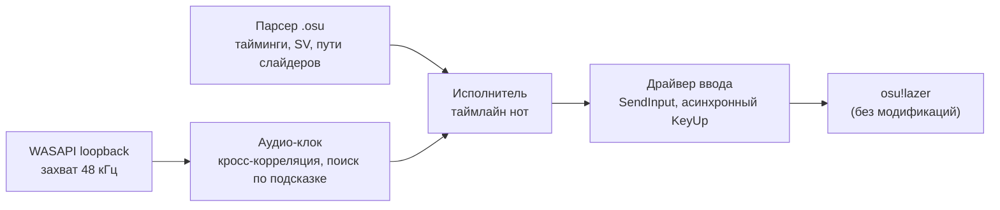

<div align="center">

# osu!-агент: играет в osu!lazer снаружи

[](https://github.com/Bileneret/osu-agent/actions/workflows/ci.yml)
[](https://www.python.org/downloads/)
[](LICENSE)

[](#key-metrics)
[](https://vshymanskyy.github.io/StandWithUkraine/)

<a href="https://vshymanskyy.github.io/StandWithUkraine/">
  
</a>

---

[English version](README.md)

---

> Читает карту, синхронизируется с музыкой через loopback звуковой карты и нажимает клавиши в нужную миллисекунду — не касаясь игры.

[▶ Полное демо: 58 секунд (10.69-star, без звука)](docs/demo/ss-kate-said.mp4)


*Живой геймплей (14 с): финальный участок карты, комбо за 2000.*


*Экран результатов карты 10.69-star: 100.00%, GREAT 1713/1713, MISS 0, комбо 2360/2360.*

</div>

---

## Что это

Агент, который играет в **osu!lazer** на картах без рейтинга, полностью офлайн,
используя только внешнюю сторону игры: смотрит на экран, слушает звуковую карту
и отправляет события клавиатуры и мыши обычным Windows-API ввода. Файл карты
`.osu` известен заранее, поэтому ни компьютерного зрения, ни реакции здесь нет —
тайминг берётся из самой музыки.

Границы заданы намеренно: клиент игры не модифицируется, память процесса не
читается, результаты никуда не отправляются, игра идёт из гостевого аккаунта.
Это инженерная витрина, а не инструмент для онлайн-игры — см. дисклеймер внизу.

---

## Ключевые метрики

*Замерено на целевой машине (Windows 11, 1920×1080@120 FPS, вывод Realtek, osu!lazer 2026.1005.0):*

| Что | Результат | Откуда цифра |
| --- | --- | --- |
| **Ранг SS** на `you are an angel — kate said` **[it's fine to dream] (10.69-star, OD10)** | **100.00%**, GREAT 1713/1713, MISS 0, комбо 2360/2360 (PERFECT), 500 510 очков | `docs/evidence/ss-kate-said-45.png`, `docs/evidence/ss-kate-said-45.log.txt` |
| Контрольный прогон на той же карте | 99.96%, GREAT 1712, OK 1, **MISS 0** | `docs/evidence/ss-kate-said-46-control.png` |
| **SS** на `Good Girls (Don't Get Used) [pearto's Easy / Normal / Hard]` (1.54-star OD2 / 2.09-star OD3.5 / 3.04-star OD6) | **100.00%** на каждой, MISS 0 | `docs/evidence/ss-good-girls-*.png` |
| 4-star `[serodose's Insane]` (4.24-star, OD8) | 96.91%, GREAT 392, OK 23, **MISS 0**, комбо 583/583 | `docs/evidence/s-good-girls-4star-od8.png` |
| Телеметрия тайминга (ошибка отправки удара) | p50 **0.0 мс**, p95 **≤ 0.01 мс**, максимум ≤ 2.6 мс | логи прогонов, поля `send_p*_ms` |
| Офлайн-набор тестов | **22 passed** | `pytest -q` |

---

## Было → стало

*Весь проект одной таблицей — измеренные точности на одном и том же наборе карт, в порядке достижения:*

| Этап | Точность | Что изменилось |
| --- | --- | --- |
| Первая попытка попаданий (день 3) | 0.07% | модель тайминга верна, но формула игрового поля неверна (курсор мимо на 40–84 px) |
| После исправления координат | 46.29% | `X = 384 + 2.25·x`, `Y = 126 + 2.25·y` проверены до 0.5 px |
| После исправления ведения слайдера | 96.71% | ошибка размерности ×1000 в ведении |
| Easy / Normal / Hard | **100.00%** на каждой | уточнение якорей, выбор свободной клавиши, упреждение курсора |
| `kate said` 10.69-star | 43.08% → **100.00%** | тихое вступление: калибровка Δ на прогревах, предсказанный старт, корреляционная перепривязка |

---

## Архитектура

Агент работает feed-forward: карта известна, поэтому единственный живой вход —
«где сейчас музыка».



| Слой | Что делает |
| --- | --- |
| `osu_agent/beatmap.py` | парсер `.osu`: тайминг-поинты, множитель слайдеров, SV из зелёных линий, времена концов слайдеров |
| `osu_agent/slider_path.py` | геометрия слайдеров: линейные / Безье / центростремительный Catmull-Rom / perfect-circle, обрезка по длине |
| `osu_agent/audio_clock.py` | захват loopback, нормированная кросс-корреляция с эталонным треком, поиск по подсказке, детект онсета |
| `osu_agent/player.py` | таймлайн нот, предсказанный старт (Δ), корреляционная перепривязка, EMA-сглаживание часов, кинематика по плотности карты |
| `osu_agent/input_driver.py` | DPI-aware SendInput, неблокирующий KeyUp через поток-релизер, выбор свободной клавиши, поднятие приоритетов процесса и потока |
| `spike/run_map.py` | оркестратор прогона: приводит игру к паузе, калибрует, играет карту, снимает экран результата |

---

## Инженерные находки

**Ошибка курсора в 89 пикселей.** Первые прогоны давали 0.07% при «идеально
позиционированном» курсоре. Игровое поле не растянуто на всю высоту 1080p: в
lazer это 0.8 логического пространства 1024×768 со сдвигом на 8 единиц, то есть
`X = 384 + 2.25·x`, `Y = 126 + 2.25·y`. Проверено HoughCircles по реальным
скриншотам: старая формула промахивалась на 40–84 px (до 191 px по краям),
новая — в пределах 0.5–1 px. Точность после исправления: 0.07% → 46.29%.

**Тысячекратная ошибка в слайдере.** `progress = (время - старт) · скорость`
смешивал секунды с osu-пикселями за *миллисекунду*: курсор прилипал к головке
слайдера, а огромная зона ведения маскировала это на лёгких картах. `velocity_sec
= velocity_ms × 1000` плюс тест-страж размерности; тики и концы слайдеров на
лёгкой карте стали 49/49 и 86/86.

**Busy-wait голодал поток записи.** Цикл спин-ожидания в главном потоке держал
GIL и не давал потоку захвата звука работать: блоки записи приходили с
разрывами, время конца перестало соответствовать склеенному сигналу, а оценка
онсета уезжала до +75 мс. Заменено на `sleep` + спин < 3 мс: поправки якоря
вернулись в диапазон ±20 мс.

**Тихое вступление ломало старт.** На `kate said` трек начинается с 3.1 с тишины,
а первая нота стоит на 5.659 с: детект по громкости цеплялся за первый *громкий*
звук (+1.95 с позже), а корреляция начинала видеть трек уже после первой ноты.
Исправлено калибровкой Δ (клик → старт трека) на прогревочных прогонах — первый
запуск после паузы холодный (1.684 → 1.620 с), поэтому он отбрасывается, — и
игрой первых нот по предсказанию, пока фоновый наблюдатель перепривязывает часы
(+13 мс в SS-прогоне). Результат: MISS 0.

**Скачки фазы часов.** Релокатор жёстко перезаписывал якорь, внося шум
корреляции ±2–5 мс мгновенными ступеньками — на OD10 (±10 мс) это само по себе
выбивало ноты в OK. Экспоненциальное сглаживание (`anchor -= 0.15 · err`) плюс
кинематика по плотности карты (удержание тапа 18 мс, хвоста слайдера 5 мс)
сократили число OK с 99 до 22 на той же карте.

---

## Структура проекта

```text
osu-agent/
├── osu_agent/                 # ядро
│   ├── beatmap.py             # парсер .osu (тайминги, SV, слайдеры)
│   ├── slider_path.py         # геометрия путей слайдеров
│   ├── audio_clock.py         # захват loopback + клок по кросс-корреляции
│   ├── player.py              # исполнитель таймлайна (круги, слайдеры, спиннеры)
│   └── input_driver.py        # драйвер SendInput, приоритеты, асинхронный KeyUp
├── spike/                     # инженерный журнал: каждый эксперимент, включая неудачи
│   ├── run_map.py             # оркестратор прогона (точка входа)
│   ├── run_ss.py              # обёртка для SS-карты
│   └── diag_*.py, measure_*.py, ...   # скрипты калибровки и диагностики
├── tests/                     # офлайн-тесты (22)
├── docs/
│   ├── demo/ss-kate-said.mp4  # демо 58 секунд (10.69-star, без звука)
│   ├── evidence/              # скриншоты результатов и логи прогонов
│   ├── day*.md                # отчёты по дням 1–3
│   └── prior_art_osu_bots.md  # обзор чужих osu!-ботов и отличия
├── osu_plan.md                # рабочий план и журнал решений
├── requirements.txt
└── .env.example               # справочник конфигурации (не файл времени выполнения)
```

---

## Быстрый старт

### Требования

- Windows 10/11, Python 3.12
- Установленный osu!lazer (без модификаций), выход из аккаунта в гостевую сессию
- Файл карты `.osu` и её аудиотрек локально (в репозитории не поставляются)

### Установка

```bash
python -m venv .venv
.venv/Scripts/pip install -r requirements.txt
```

### Тесты

```bash
.venv/Scripts/python -m pytest tests -q
```

Набор офлайн: работает без игры, без звукового устройства и без карт.

### Использование

```bash
.venv/Scripts/python spike/run_map.py \
    --osu path/to/beatmap.osu \
    --audio path/to/track.mp3 \
    --cpu -1
```

Раннер приводит игру к экрану паузы (song select, экран результатов и экран
провала распознаются по цвету), калибрует старт трека, играет карту и сохраняет
скриншот результата. Полезные флаги: `--test` (сыграть только первый объект),
`--until <мс>` (короткий зонд), `--anchor {auto,onset,corr}`.

---

## Честные ограничения

- **Только Windows.** Слой ввода — `SendInput`, аудио-клок — WASAPI loopback,
  управление окном игры — через `ctypes`.
- **120 FPS — стабильная настройка.** 240 FPS выглядели лучше на бумаге, но
  давали залипания планировщика (`send_max` 30 мс) и 5 потерянных нот; при
  120 FPS p95 отправки удара — 0.01 мс.
- **Одна нота в OK в контрольном прогоне** (99.96%): остаточный джиттер даёт
  квантование обработки ввода в игре (окно ±10 мс на OD10). Три SS-прогона
  показывают, что он не накапливается, но он не нулевой.
- **Первая нота карты физически недостижима только по звуку**: она может
  звучать раньше, чем первый слышимый сэмпл трека становится детектируемым.
  Это закрывается калиброванным предсказанным стартом, ошибка которого должна
  оставаться в пределах ~8 мс.
- **Движения курсора не человекоподобны.** Это осознанный выбор в пользу
  точности: мгновенное перемещение с коротким упреждением, без профиля
  Minimum-Jerk, перелётов и дрожания.
- **Карты и аудио не поставляются** (сторонний лицензированный контент).
  В репозитории только код, тесты, документация, скриншоты-доказательства и логи.

---

## Благодарности и дисклеймер

Проект построен на [NumPy](https://numpy.org/) (BSD-3), [soundfile](https://python-soundfile.readthedocs.io/)
(BSD-3), [SoundCard](https://github.com/bastibe/SoundCard) (BSD-3), [mss](https://github.com/BoboTiG/python-mss)
(MIT), [Pillow](https://python-pillow.org/) (MIT-CMU) и [rosu-pp-py](https://github.com/MaxOhn/rosu-pp-py) (MIT).
Оформление README следует другим репозиториям автора.

**Назначение.** Это исследовательская и инженерная витрина: тайминг,
синхронизация со звуком и точность ввода. Это не инструмент для онлайн-игры, и
автор не поддерживает его использование для получения несправедливого
преимущества в сетевой игре. Автоматизация сторонних сервисов может нарушать их
условия использования; применяйте это ПО только там, где вы на это уполномочены.

---

## Лицензия

MIT — см. [LICENSE](LICENSE). Дополнительное уведомление в файле повторяет ту же
границу: только офлайн-исследование, не для читерства в онлайне.
